<p align="center">
  <a href="https://x.com/potential_dev">
    
  </a>
</p>

<p align="center">
  <a href="https://github.com/KamalPixel">
    
  </a>
</p>

<p align="center">
  <a href="https://leqtio.dev"></a>
  <a href="https://verkstedweb.no"></a>
  <a href="https://www.linkedin.com/in/kamal-mahad-317191308/"></a>
  <a href="https://x.com/potential_dev"></a>
  <a href="mailto:kamash02@outlook.com"></a>
</p>

```ts
const kamal = {
  location: "Østfold, Norway",
  studying: "Computer Engineering",
  building: ["ChessNextDoor", "Leqtio", "verkstedweb.no"],
  currentlyLearning: ["Software testing", "Discrete math"],
  askMeAbout: ["Payment idempotency", "Cloudflare Workers", "AI in the classroom"],
};
```

## 🚀 Projects

<details>
<summary><b>♟️ ChessNextDoor</b> · a platform for learning chess · 🚧 In development</summary>
<br>

I'm building a platform where you learn chess from scratch. It's my newest project and hasn't launched yet.

</details>

<details>
<summary><b>🎮 Leqtio</b> · AI-generated learning games for teachers · 🏆 County champion</summary>
<br>

A teacher picks a curriculum goal and Leqtio generates a game the class can play.

- REST API in **Django Ninja** with Pydantic validation and OpenAPI docs
- **Claude API** integration that retries on 429 and 504 and filters inappropriate content
- Cascade deletes: removing a game wipes every row of student data tied to it (GDPR)
- We won the Østfold county final for student companies and competed in the national final

</details>

<details>
<summary><b>💳 Bakery webshop backend</b> · Stripe checkout on Cloudflare Workers</summary>
<br>

I moved the backend from PHP/MySQL to **TypeScript on Cloudflare Workers + D1**.

- Idempotency on three layers (client token, DB constraint, Stripe key) stops double charges
- The client sends product ID and quantity. The server sets the price in øre from a catalog built at deploy time
- Stripe webhooks with signature checks and event dedup trigger order emails through Resend
- PBKDF2 through WebCrypto keeps password hashing inside the 10 ms CPU limit

</details>

<details>
<summary><b>🍜 Restaurant booking + SMS</b> · full-stack reservation system</summary>
<br>

- Guests book online and get an SMS confirmation. Staff get an alert
- Guests who opt in get a review request by SMS 4 hours after their visit, never after 21:30
- Holiday mode turns off booking on set dates without a redeploy
- A custom prerender script turns React routes into static HTML with JSON-LD for SEO

</details>

## 🛠️ Stack

**Languages**

<p align="center">
  
</p>

**Frameworks & tools**

<p align="center">
  
</p>

## 📊 Activity

<p align="center">
  <picture>
    <source media="(prefers-color-scheme: dark)" srcset="https://raw.githubusercontent.com/KamalPixel/KamalPixel/output/github-snake-dark.svg" />
    
  </picture>
</p>


